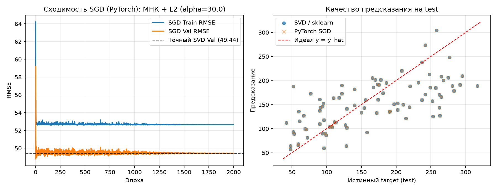
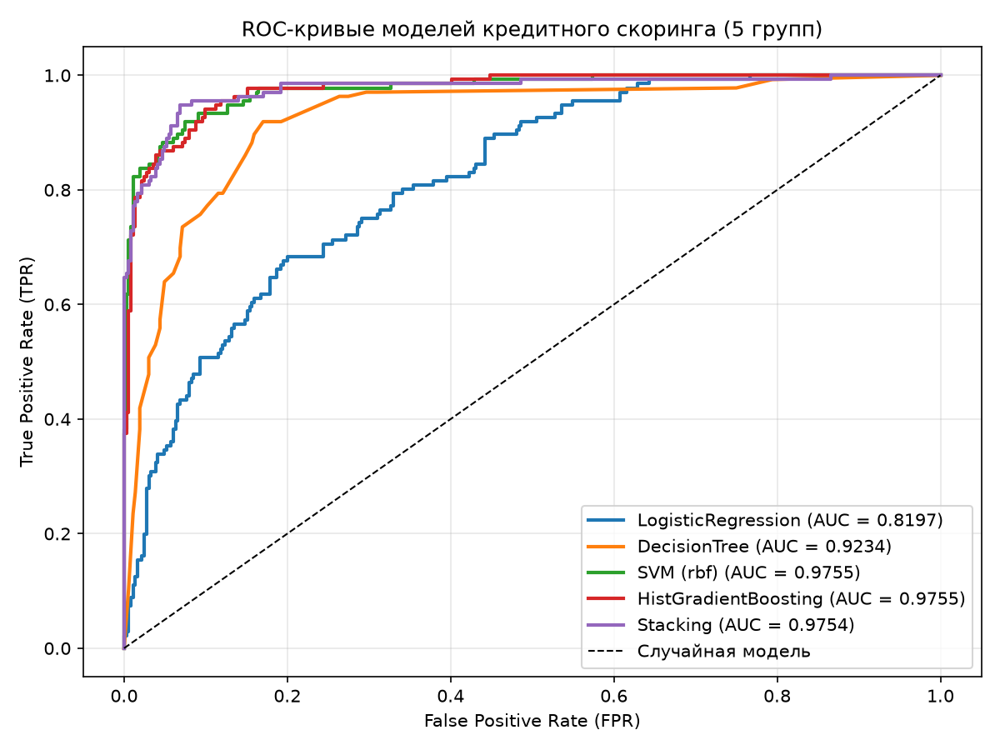
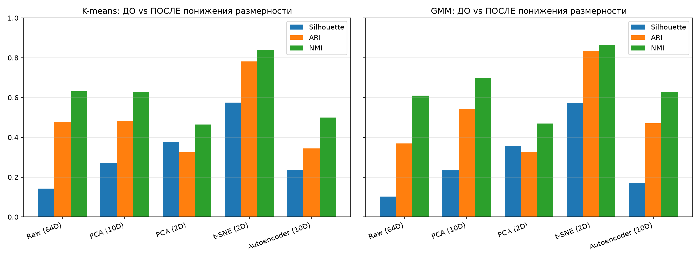

# Лабораторные работы по алгоритмам машинного обучения

В репозитории собраны три лабораторные работы на Python (все эксперименты воспроизводятся оффлайн на встроенных датасетах `scikit-learn`).

---

## Лабораторная работа №1 — линейная регрессия, Feature Engineering и МНК

**Код:** [`lab1_linear_regression.py`](lab1_linear_regression.py) · **Полный отчёт:** [`reports/lab1_report.md`](reports/lab1_report.md)

### Пояснение к работе
Задача — минимизировать ошибку **RMSE** исключительно линейными методами (нейросети, бустинги и случайный лес запрещены), дополнительно отслеживая **MAE** и **$R^2$**. Для экспериментов взят встроенный датасет `load_diabetes(scaled=False)` (`442` объекта), к нему построчно без утечки добавлены два категориальных признака (`sex_cat`, `bmi_cat`) и `3%` случайных `NaN` в числовые столбцы (для проверки импьютации). Выборка разделена на `train / val / test = 265 / 88 / 89` (`60% / 20% / 20%`); импьютеры (`SimpleImputer`), `OneHotEncoder`, `StandardScaler`, границы выбросов (IQR), групповые агрегаты и отбор признаков обучались строго на `train`.

### Краткий отчёт
- **Baseline и Feature Engineering:** базовый `Ridge (alpha=10.0)` дал `val-RMSE = 50.0820` (чистый МНК — `50.4109`). Полиномы `PolynomialFeatures(degree=2)` без регуляризации сильно переобучились (`val-RMSE = 54.9434`), а избыток узлов B-сплайна (`knots=7, 10`) ухудшил обобщение. Лучший прирост дали кубические B-сплайны `SplineTransformer(knots=3)` с отбором признаков `RFE (Ridge, alpha=30.0)`: оставлено `12` из `48` признаков, ошибка снизилась до **`val-RMSE = 49.4379`** (`-0.6440` к baseline, `MAE = 38.8100`, `R^2 = 0.5760`).
- **Четыре реализации МНК (на итоговой матрице `265 × 12`, $\text{cond}(X) = 29.45$):** реализованы вручную нормальные уравнения `(X_b^T X_b + αD)^{-1} X_b^T y`, `SVD` с фильтром Тихонова и мини-батч `SGD` на PyTorch (с масштабированием вклада L2-штрафа на размер батча $m/n_{\text{train}}$, чтобы сумма по эпохе точно совпадала с функционалом `Ridge`).

| Режим | Метод | Train RMSE | Val RMSE | Test RMSE | Test R² | Max \|w − w_sklearn\| |
|---|---|---:|---:|---:|---:|---:|
| Чистый МНК ($\alpha = 0$) | Normal Equations / SVD / sklearn | 52.0754 | 50.9255 | 59.6210 | 0.3855 | 0.0000 |
| Чистый МНК ($\alpha = 0$) | SGD (PyTorch) | 52.0754 | 50.9259 | 59.6210 | 0.3855 | 0.0056 |
| МНК + L2 ($\alpha = 30.0$) | Normal Equations / SVD / sklearn | 52.6417 | **49.4379** | **58.1175** | **0.4161** | 0.0000 |
| МНК + L2 ($\alpha = 30.0$) | SGD (PyTorch) | 52.6415 | 49.4384 | 58.1177 | 0.4161 | 0.0028 |

---

## Лабораторная работа №2 — бинарный кредитный скоринг (`scikit-learn`)

**Код:** [`lab2_credit_scoring.py`](lab2_credit_scoring.py) · **Полный отчёт:** [`reports/lab2_report.md`](reports/lab2_report.md)

### Пояснение к работе
Задача бинарной классификации (`0` — кредит одобрен, `1` — дефолт) решена на пяти семействах моделей только средствами `scikit-learn`: **логистическая регрессия**, **деревья решений**, **SVM** (`linear` и `rbf` с вероятностной калибровкой `CalibratedClassifierCV`), **бустинг** (`GradientBoosting`, `HistGradientBoosting`, `AdaBoost`) и **ансамблинг** (`RandomForest`, `Voting`, `Stacking`). Данные (`2500` объектов, `12` скоринговых признаков, баланс классов `72.8% / 27.2%`) разделены стратифицированно на `2000 / 500`; гиперпараметры подбирались через 5-fold `StratifiedKFold` по `ROC-AUC`. Помимо `ROC-AUC` и `F1`, считались банковские метрики $\text{Gini} = 2\cdot\text{ROC-AUC}-1$ и $\text{KS} = \max_t(\text{TPR}(t)-\text{FPR}(t))$.

### Краткий отчёт
Линейные модели (`LogisticRegression`, `SVM linear`) показали умеренное качество из-за нелинейной структуры классов (`n_clusters_per_class=2`), одиночное дерево решений заметно улучшило результат (`Train ROC-AUC = 0.9360`, `Test = 0.9234`), а лучшими стали градиентный бустинг, RBF-SVM и стекинг:

| Модель | Группа | ROC-AUC | Gini | KS | F1 |
|---|---|---:|---:|---:|---:|
| **HistGradientBoosting** | 4. Бустинг | **0.9755** | **0.9510** | 0.8423 | 0.8722 |
| **SVM (rbf)** | 3. SVM | **0.9755** | 0.9509 | 0.8449 | 0.8664 |
| **Stacking** | 5. Ансамблинг | 0.9754 | 0.9509 | **0.8798** | **0.8727** |
| DecisionTree | 2. Деревья решений | 0.9234 | 0.8468 | 0.7488 | 0.7546 |
| LogisticRegression | 1. Логистическая регрессия | 0.8197 | 0.6394 | 0.4833 | 0.5889 |

---

## Лабораторная работа №3 — кластеризация и понижение размерности (50+ признаков)

**Код:** [`lab3_clustering_dim_red.py`](lab3_clustering_dim_red.py) · **Полный отчёт:** [`reports/lab3_report.md`](reports/lab3_report.md)

### Пояснение к работе
Использован датасет `load_digits` (`1797` изображений цифр `0..9`, **`64` признака** $\ge 50$), стандартизованный через `StandardScaler`. В пространстве большой размерности расстояния между точками сглаживаются, а оценка полных ковариационных матриц для `GMM` затруднена. Поэтому сравнивалось качество кластеризации **ДО** сжатия (`Raw 64D`, `K-means` и `GMM` при $k=10$) и **ПОСЛЕ** применения трёх методов понижения размерности: **PCA** (`10D` объясняет `58.87%` дисперсии, `2D`), **t-SNE** (`2D`, `perplexity=30`) и полносвязного **автоэнкодера на PyTorch** (`64 → 32 → 16 → 10 → 16 → 32 → 64`, 120 эпох, ошибка реконструкции MSE снизилась с `0.9586` до `0.2615`).

### Краткий отчёт
Качество оценивалось по компактности кластеров (`Silhouette` ↑, `Davies-Bouldin` ↓) и совпадению с истинными цифрами без использования меток при обучении (`ARI` ↑, `NMI` ↑):

| Представление | Алгоритм | Silhouette | ARI | NMI | ΔARI к Raw 64D |
|---|---|---:|---:|---:|---:|
| Raw (64D) — ДО | K-means / GMM | 0.1423 / 0.1031 | 0.4780 / 0.3701 | 0.6319 / 0.6103 | 0.0000 / 0.0000 |
| PCA (10D) | K-means / GMM | 0.2732 / 0.2349 | 0.4831 / 0.5435 | 0.6277 / 0.6982 | +0.0051 / +0.1735 |
| PCA (2D) | K-means / GMM | 0.3770 / 0.3571 | 0.3253 / 0.3284 | 0.4645 / 0.4701 | −0.1526 / −0.0416 |
| **t-SNE (2D)** | **K-means / GMM** | **0.5742** / 0.5724 | 0.7813 / **0.8344** | 0.8391 / **0.8654** | +0.3033 / **+0.4643** |
| Autoencoder (10D) | K-means / GMM | 0.2370 / 0.1707 | 0.3443 / 0.4708 | 0.5003 / 0.6278 | −0.1337 / +0.1007 |

Нелинейное вложение `t-SNE (2D)` дало наибольший прирост по всем метрикам (лучший `ARI = 0.8344` у `GMM`, лучший `Silhouette = 0.5742` у `K-means`). Сжатие до `10D` через `PCA` и автоэнкодер заметно улучшило `GMM` (`+0.1735` и `+0.1007` к `ARI`), тогда как `PCA (2D)` отбросило слишком много дисперсии, снизив `ARI` ниже исходного `Raw 64D`.

