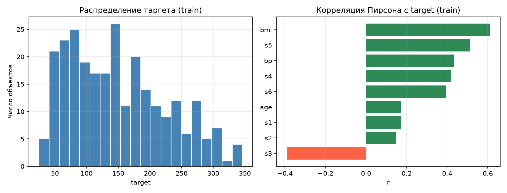
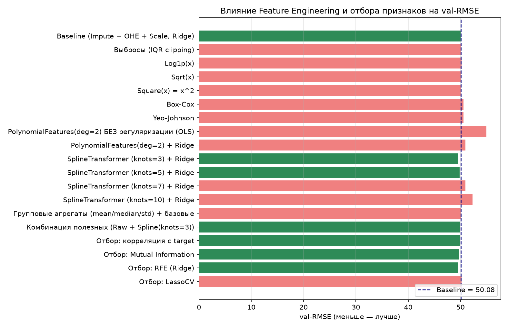
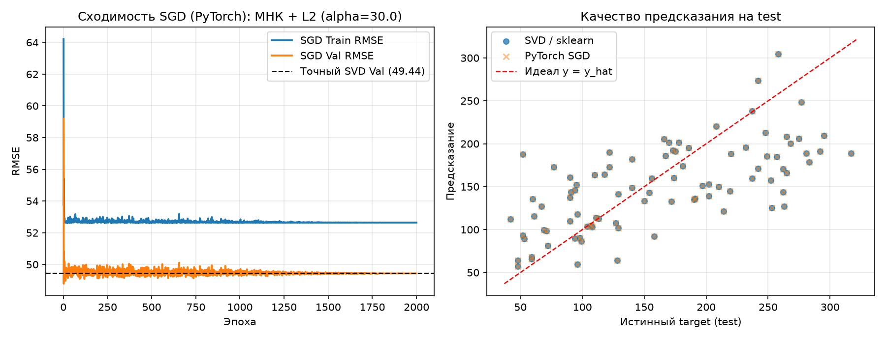

# Отчёт по лабораторной работе №1: соревнование по линейной регрессии (PyTorch)

**Код:** [`lab1_linear_regression.py`](../lab1_linear_regression.py)

## 1. Постановка задачи и подготовка данных

Цель работы — минимизировать ошибку **RMSE** на линейных моделях (нейросети, бустинги и случайный лес не используются), дополнительно логируя **MAE** и **$R^2$**:

$$\text{RMSE}(y, \hat{y}) = \sqrt{\frac{1}{n}\sum_{i=1}^{n}(y_i - \hat{y}_i)^2}, \qquad \text{MAE}(y, \hat{y}) = \frac{1}{n}\sum_{i=1}^{n}|y_i - \hat{y}_i|, \qquad R^2 = 1 - \frac{\sum_{i=1}^n (y_i - \hat{y}_i)^2}{\sum_{i=1}^n (y_i - \bar{y})^2}.$$

Для воспроизводимости зафиксированы все генераторы случайных чисел (`SEED = 42` для `random`, `numpy`, `torch`).

- **Датасет:** встроенный `sklearn.datasets.load_diabetes(scaled=False)` — `442` объекта, `9` числовых признаков (`age`, `bmi`, `bp`, `s1..s6`).
- **Категориальные признаки (сформированы построчно без утечки):**
  - `sex_cat`: `'F'` / `'M'` из исходного столбца `sex` (исходный `sex` удалён);
  - `bmi_cat`: `'normal'` ($\text{bmi} < 25$), `'overweight'` ($25 \le \text{bmi} < 30$), `'obese'` ($\text{bmi} \ge 30$).
- **Пропуски:** так как во встроенном `load_diabetes` пропусков нет, в числовые признаки добавлены 3% случайных `NaN` (`age`: 16, `bmi`: 11, `bp`: 10, `s1`: 10, `s2`: 8, `s3`: 18, `s4`: 11, `s5`: 8, `s6`: 12; таргет не изменялся) для проверки этапа импьютации.
- **Разбиение выборки:** `train / val / test = 265 / 88 / 89` (`60% / 20% / 20%`). Весь препроцессинг, генерация агрегатов, масштабирование и отбор признаков обучались строго на `train`.

---

## 2. Краткий EDA

Статистики таргета на `train` ($n = 265$): среднее `151.03`, стандартное отклонение `77.33`, минимум `25.0`, медиана `141.0`, максимум `346.0`.

Корреляции Пирсона числовых признаков с `target` на `train`:
- `bmi`: `+0.6106`
- `s5`: `+0.5133`
- `bp`: `+0.4341`
- `s4`: `+0.4178`
- `s6`: `+0.3934`
- `s3`: `-0.3915`
- `age`: `+0.1738`
- `s1`: `+0.1710`
- `s2`: `+0.1479`

---

## 3. Препроцессинг и Baseline

На `train` обучены:
- `SimpleImputer(strategy="median")` для числовых признаков и `SimpleImputer(strategy="most_frequent")` для категориальных;
- `OneHotEncoder(drop="first", sparse_output=False)` для `sex_cat` и `bmi_cat`;
- `StandardScaler()` для числовых признаков;
- проверка выбросов по правилу Тьюки $[Q_1 - 1.5 \cdot \text{IQR},\; Q_3 + 1.5 \cdot \text{IQR}]$ (обрезано 39 значений на `train` и 9 на `val`).

Базовые модели на `val`:
- `Baseline (OLS)`: `val-RMSE = 50.4109`, `MAE = 40.0677`, `R^2 = 0.5592`
- `Baseline (Ridge, alpha = 10.0)`: `val-RMSE = 50.0820`, `MAE = 39.7560`, `R^2 = 0.5649`

---

## 4. Feature Engineering и отбор признаков

Каждое преобразование оценивалось по приросту `val-RMSE` относительно baseline (`50.0820`). Затем из полезных блоков собрана комбинация и проверены 4 метода отбора признаков (`корреляция с target`, `mutual_info_regression`, `RFE`, `LassoCV`). Полная таблица сохранена в [`outputs/lab1/transformation_report.csv`](../outputs/lab1/transformation_report.csv):

| Трансформация | Признаков | Alpha | val-RMSE | ΔRMSE к baseline | val-MAE | val-R2 | Полезно |
|---|---:|---:|---:|---:|---:|---:|:---:|
| Baseline (Impute + OHE + Scale, Ridge) | 12 | 10.0000 | 50.0820 | 0.0000 | 39.7560 | 0.5649 | True |
| Выбросы (IQR clipping) | 12 | 5.0000 | 50.0834 | +0.0015 | 39.6311 | 0.5649 | False |
| Log1p(x) | 12 | 5.0000 | 50.2212 | +0.1392 | 40.3072 | 0.5625 | False |
| Sqrt(x) | 12 | 5.0000 | 50.1188 | +0.0368 | 40.0715 | 0.5643 | False |
| Square(x) = x^2 | 12 | 10.0000 | 50.1689 | +0.0870 | 39.3464 | 0.5634 | False |
| Box-Cox | 12 | 1.0000 | 50.5679 | +0.4860 | 40.6302 | 0.5564 | False |
| Yeo-Johnson | 12 | 1.0000 | 50.5676 | +0.4856 | 40.6355 | 0.5564 | False |
| PolynomialFeatures(deg=2) БЕЗ регуляризации (OLS) | 57 | 0.0000 | 54.9434 | +4.8615 | 43.5111 | 0.4764 | False |
| PolynomialFeatures(deg=2) + Ridge | 57 | 30.0000 | 50.9480 | +0.8661 | 39.0489 | 0.5497 | False |
| **SplineTransformer (knots=3) + Ridge** | 39 | 30.0000 | 49.5885 | -0.4935 | 38.9642 | 0.5735 | **True** |
| **SplineTransformer (knots=5) + Ridge** | 57 | 30.0000 | 49.8312 | -0.2507 | 40.1549 | 0.5693 | **True** |
| SplineTransformer (knots=7) + Ridge | 75 | 100.0000 | 50.9551 | +0.8732 | 41.7258 | 0.5496 | False |
| SplineTransformer (knots=10) + Ridge | 102 | 100.0000 | 52.3130 | +2.2310 | 43.1132 | 0.5253 | False |
| Групповые агрегаты (mean/median/std) + базовые | 42 | 10.0000 | 50.1587 | +0.0767 | 39.8097 | 0.5636 | False |
| **Комбинация полезных (Raw + Spline(knots=3))** | 48 | 30.0000 | 49.8997 | -0.1823 | 38.9003 | 0.5681 | **True** |
| **Отбор: корреляция с target** | 48 | 30.0000 | 49.8997 | -0.1823 | 38.9003 | 0.5681 | **True** |
| **Отбор: Mutual Information** | 24 | 1.0000 | 49.7584 | -0.3236 | 39.1300 | 0.5705 | **True** |
| **Отбор: RFE (Ridge)** | **12** | **30.0000** | **49.4379** | **-0.6440** | **38.8100** | **0.5760** | **True** |
| Отбор: LassoCV | 19 | 30.0000 | 50.1847 | +0.1027 | 39.2519 | 0.5631 | False |

**Итог отбора:** комбинация исходных признаков со сплайнами `SplineTransformer(n_knots=3, degree=3)` и отбором `RFE (Ridge)` оставила **12 из 48 признаков** и улучшила `val-RMSE` с `50.0820` до `49.4379` (`-0.6440`, `R^2 = 0.5760`). Также наглядно видно переобучение полиномов без регуляризации (`54.9434`) и быстрый рост ошибки при избытке узлов B-сплайна (`knots=7, 10`).

---

## 5. Четыре реализации МНК

На итоговой матрице `265 × 12` (число обусловленности $\text{cond}(X) = 29.45$) реализованы и сравнены 4 способа решения задачи $\min_{w, b} \|Xw + b - y\|_2^2 + \alpha \|w\|_2^2$ (свободный член $b$ не штрафуется):

1. **Normal Equations** (`fit_normal_equations`):
   $$\theta = (X_b^T X_b + \alpha D)^{-1} X_b^T y, \qquad D = \operatorname{diag}(0, 1, \dots, 1).$$
2. **SVD** (`fit_svd`): центрируем $X_c = U \Sigma V^T$, $y_c = y - \bar{y}$, вычисляем веса через фильтр Тихонова:
   $$w = V \operatorname{diag}\!\left(\frac{\sigma_i}{\sigma_i^2 + \alpha}\right) U^T y_c, \qquad b = \bar{y} - \bar{x}^T w.$$
3. **SGD на PyTorch** (`fit_sgd_pytorch`): мини-батч градиентный спуск (`batch_size=64`, `lr=0.02`, `momentum=0.9`, `CosineAnnealingLR`, `2000` эпох, `float64`). Для точной эквивалентности `Ridge(alpha)` на батче размера $m = |\mathcal{B}|$ при $B_{\text{nom}} = 64$ минимизируется:
   $$L_{\mathcal{B}}(w, b) = \frac{1}{B_{\text{nom}}}\sum_{i \in \mathcal{B}} (x_i^T w + b - y_i)^2 + \frac{\alpha \cdot m}{n_{\text{train}} \cdot B_{\text{nom}}} \|w\|_2^2,$$
   так что сумма вкладов по всем батчам эпохи (включая последний неполный батч) в точности совпадает с функционалом `Ridge`.
4. **sklearn** (`LinearRegression` при $\alpha=0$, `Ridge(alpha=30.0)`).

Таблица сравнения ([`outputs/lab1/ols_comparison.csv`](../outputs/lab1/ols_comparison.csv)):

| Режим | Метод | Train RMSE | Val RMSE | Test RMSE | Test MAE | Test R2 | Max \|w - w_sklearn\| | Время (мс) |
|---|---|---:|---:|---:|---:|---:|---:|---:|
| Чистый МНК (alpha=0) | Normal Equations | 52.075406 | 50.925515 | 59.620981 | 47.396114 | 0.385487 | 0.000000 | 0.063761 |
| Чистый МНК (alpha=0) | SVD | 52.075406 | 50.925515 | 59.620981 | 47.396114 | 0.385487 | 0.000000 | 0.109293 |
| Чистый МНК (alpha=0) | SGD (PyTorch) | 52.075406 | 50.925854 | 59.621036 | 47.396085 | 0.385486 | 0.005567 | 2346.835815 |
| Чистый МНК (alpha=0) | sklearn | 52.075406 | 50.925515 | 59.620981 | 47.396114 | 0.385487 | 0.000000 | 0.676646 |
| МНК + L2 (alpha=30.0) | Normal Equations | 52.641724 | 49.437931 | 58.117491 | 46.653198 | 0.416089 | 0.000000 | 0.058913 |
| МНК + L2 (alpha=30.0) | SVD | 52.641724 | 49.437931 | 58.117491 | 46.653198 | 0.416089 | 0.000000 | 0.107350 |
| МНК + L2 (alpha=30.0) | SGD (PyTorch) | 52.641540 | 49.438380 | 58.117718 | 46.653185 | 0.416084 | 0.002814 | 1676.251510 |
| МНК + L2 (alpha=30.0) | sklearn | 52.641724 | 49.437931 | 58.117491 | 46.653198 | 0.416089 | 0.000000 | 0.544290 |

## 6. Выводы

1. Нелинейные B-сплайны (`SplineTransformer`, `knots=3`) в сочетании с регуляризацией Ridge (`alpha=30.0`) и отбором признаков `RFE` позволили снизить `val-RMSE` с `50.0820` до `49.4379`, а L2-регуляризация снизила `Test RMSE` с `59.6210` (чистый МНК) до `58.1175` (рост `Test R^2` с `0.3855` до `0.4161`).
2. Ручные реализации `Normal Equations` и `SVD` совпали с решением `sklearn` с машинной точностью (`Max |w - w_sklearn| = 0.000000`), а мини-батч `SGD (PyTorch)` сошёлся к точному решению с отклонением весов не более `0.0056` (`alpha=0`) и `0.0028` (`alpha=30.0`).
