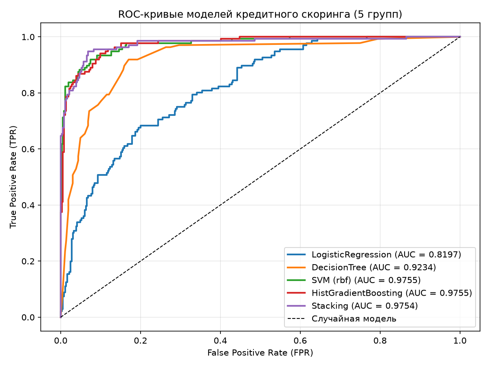
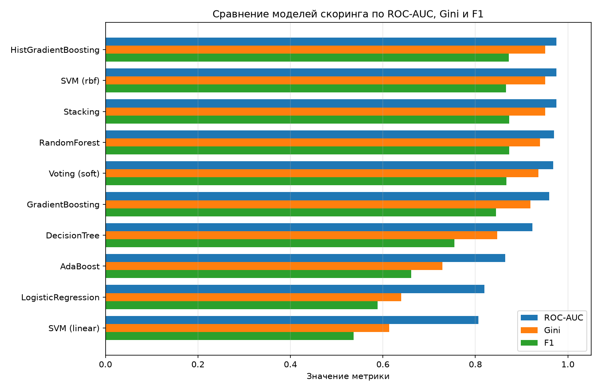
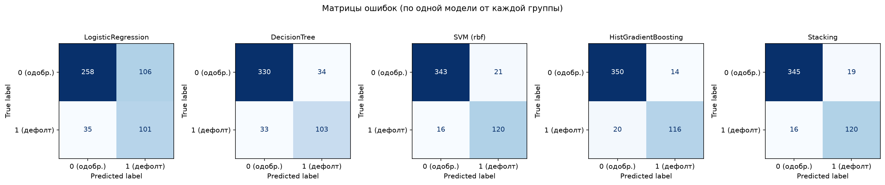

# Отчёт по лабораторной работе №2: бинарный кредитный скоринг (да / нет)

**Код:** [`lab2_credit_scoring.py`](../lab2_credit_scoring.py)

## 1. Постановка задачи и данные

Задача бинарной классификации (`0` — кредит одобрен / нет дефолта, `1` — отказ / дефолт) решена на пяти семействах моделей исключительно средствами `scikit-learn`:
1. Логистическая регрессия;
2. Деревья решений;
3. SVM (`linear` и `rbf`);
4. Бустинг (`GradientBoosting`, `HistGradientBoosting`, `AdaBoost`);
5. Ансамблинг (`RandomForest`, `VotingClassifier`, `StackingClassifier`).

- **Датасет:** сгенерирован оффлайн встроенным `sklearn.datasets.make_classification` (`SEED = 42`): `2500` объектов, `12` скоринговых признаков (`age`, `monthly_income`, `loan_amount`, `credit_term`, `debt_to_income`, `credit_history_len`, `num_open_loans`, `num_delays_90d`, `employment_years`, `savings_ratio`, `collateral_score`, `utilization_rate`).
- **Баланс классов:** `0` — `1821` (`72.8%`), `1` — `679` (`27.2%`).
- **Разбиение:** стратифицированное `train / test = 2000 / 500` (`80% / 20%`). Подбор гиперпараметров выполнялся по `5-fold StratifiedKFold` с целевой метрикой `ROC-AUC`.

---

## 2. Метрики качества

Помимо стандартных метрик бинарной классификации (`Accuracy`, `Precision`, `Recall`, `F1`), в кредитном скоринге оцениваются:

$$\text{Gini} = 2 \cdot \text{ROC-AUC} - 1, \qquad \text{KS} = \max_{t} \bigl(\text{TPR}(t) - \text{FPR}(t)\bigr),$$

где $\text{KS}$ (статистика Колмогорова–Смирнова) измеряет максимальное расхождение между распределениями вероятностей дефолта для классов `1` и `0`.

---

## 3. Подбор моделей по группам

1. **Логистическая регрессия** (`StandardScaler + LogisticRegression`):
   - Лучшие параметры: `C = 10.0`, `class_weight = 'balanced'`, `CV ROC-AUC = 0.7758`.
   - Наибольшие по модулю веса на `train`: `monthly_income (+0.8461)`, `utilization_rate (+0.3227)`, `credit_term (+0.2752)`, `num_open_loans (-0.2367)`, `debt_to_income (-0.1413)`, `num_delays_90d (-0.1049)`.
2. **Деревья решений** (`DecisionTreeClassifier`):
   - Лучшие параметры: `max_depth = 7`, `min_samples_leaf = 15`, `class_weight = None`, `CV ROC-AUC = 0.8508`.
   - Контроль переобучения: `Train ROC-AUC = 0.9360`, `Test ROC-AUC = 0.9234` (небольшой зазор без сильного переобучения).
   - Топ-5 важных признаков: `monthly_income (0.3002)`, `credit_term (0.2088)`, `num_delays_90d (0.1577)`, `num_open_loans (0.0838)`, `employment_years (0.0574)`.
3. **SVM** (`StandardScaler + CalibratedClassifierCV(SVC)`):
   - `SVM (linear)`: `C = 5.0`, `CV ROC-AUC = 0.7514`;
   - `SVM (rbf)`: `C = 1.0`, `gamma = 0.1`, `CV ROC-AUC = 0.9266`.
4. **Бустинг (`sklearn.ensemble`)**:
   - `GradientBoosting`: `n_estimators = 200`, `learning_rate = 0.1`, `max_depth = 3`, `CV ROC-AUC = 0.9211`;
   - `HistGradientBoosting`: `max_iter = 200`, `learning_rate = 0.1`, `max_depth = None`, `CV ROC-AUC = 0.9276`;
   - `AdaBoost`: `n_estimators = 250`, `learning_rate = 1.0`, `CV ROC-AUC = 0.8320`.
5. **Ансамблинг (`sklearn.ensemble`)**:
   - `RandomForest`: `n_estimators = 300`, `max_depth = None`, `min_samples_leaf = 2`, `CV ROC-AUC = 0.9261`;
   - `Voting (soft)` на лучших `LogReg`, `SVM (rbf)`, `GradientBoosting`, `RandomForest`;
   - `Stacking` на `LogReg`, `DecisionTree`, `SVM (rbf)`, `GradientBoosting`, `RandomForest` с мета-моделью `LogisticRegression`.

---

## 4. Сводная таблица результатов на тестовой выборке

Таблица из [`outputs/lab2/models_comparison.csv`](../outputs/lab2/models_comparison.csv) (отсортирована по `ROC-AUC`):

| Модель | Группа | ROC-AUC | Gini | KS | Accuracy | Precision | Recall | F1 |
|---|---|---:|---:|---:|---:|---:|---:|---:|
| **HistGradientBoosting** | 4. Boosting | **0.9755** | **0.9510** | 0.8423 | **0.9320** | **0.8923** | 0.8529 | 0.8722 |
| **SVM (rbf)** | 3. SVM | **0.9755** | 0.9509 | 0.8449 | 0.9260 | 0.8511 | 0.8824 | 0.8664 |
| **Stacking** | 5. Ensemble | 0.9754 | 0.9509 | **0.8798** | 0.9300 | 0.8633 | 0.8824 | **0.8727** |
| RandomForest | 5. Ensemble | 0.9699 | 0.9397 | 0.8458 | 0.9300 | 0.8633 | 0.8824 | **0.8727** |
| Voting (soft) | 5. Ensemble | 0.9680 | 0.9360 | 0.8670 | 0.9260 | 0.8462 | **0.8897** | 0.8674 |
| GradientBoosting | 4. Boosting | 0.9595 | 0.9191 | 0.7999 | 0.9140 | 0.8298 | 0.8603 | 0.8448 |
| DecisionTree | 2. DecisionTree | 0.9234 | 0.8468 | 0.7488 | 0.8660 | 0.7518 | 0.7574 | 0.7546 |
| AdaBoost | 4. Boosting | 0.8645 | 0.7291 | 0.5855 | 0.8400 | 0.7800 | 0.5735 | 0.6610 |
| LogisticRegression | 1. LogReg | 0.8197 | 0.6394 | 0.4833 | 0.7180 | 0.4879 | 0.7426 | 0.5889 |
| SVM (linear) | 3. SVM | 0.8068 | 0.6136 | 0.5254 | 0.8100 | 0.7971 | 0.4044 | 0.5366 |

---

## 5. Графики

## 6. Выводы

1. Линейные модели (`LogisticRegression` с `ROC-AUC = 0.8197` и `SVM (linear)` с `0.8068`) существенно уступают нелинейным методам, так как классы имеют по 2 кластера на класс и нелинейную границу решений.
2. Одиночное дерево решений (`DecisionTree`, `ROC-AUC = 0.9234`) заметно выигрывает у линейных моделей, но проигрывает ансамблям и нелинейному SVM.
3. Лидерами по качеству оказались `HistGradientBoosting` (`ROC-AUC = 0.9755`, `Gini = 0.9510`), `SVM (rbf)` (`ROC-AUC = 0.9755`) и `Stacking` (`ROC-AUC = 0.9754`, максимальный `KS = 0.8798` и `F1 = 0.8727`).
