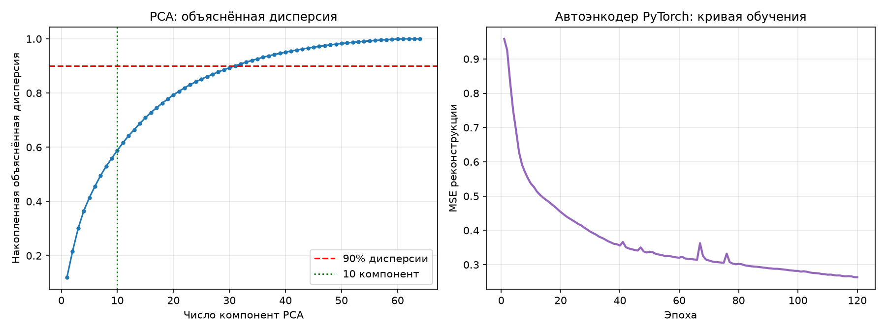
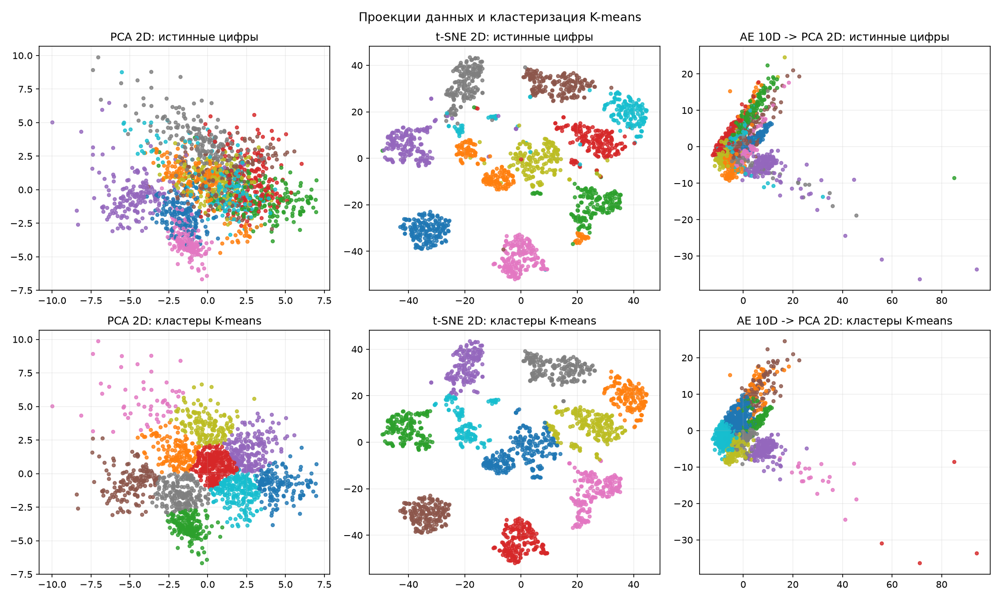
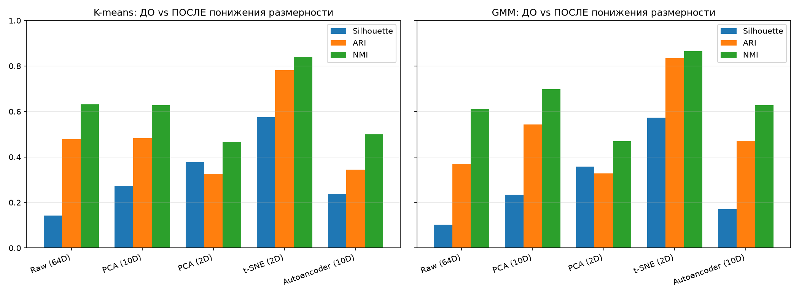

# Отчёт по лабораторной работе №3: кластеризация и понижение размерности (50+ признаков)

**Код:** [`lab3_clustering_dim_red.py`](../lab3_clustering_dim_red.py)

## 1. Постановка задачи и данные

Этапы работы по заданию:
1. Подобрать датасет с **50+ признаками**;
2. Кластеризовать данные (`K-means` и `GMM`), сохранить результаты;
3. Применить методы понижения размерности: **PCA**, **t-SNE** и **автоэнкодер (PyTorch)**;
4. Повторно кластеризовать сжатые представления (`K-means` и `GMM`);
5. Сравнить результаты **ДО** и **ПОСЛЕ** понижения размерности.

- **Датасет:** встроенный `sklearn.datasets.load_digits` — `1797` объектов, **`64` признака** ($\ge 50$), `10` истинных классов (цифры `0..9`). Перед обучением все признаки масштабированы `StandardScaler`.
- **Проверка числа кластеров $k$ (метод локтя и Silhouette на 64 признаках):**
  - $k = 6$: Inertia `81678.5`, Silhouette `0.0988`
  - $k = 8$: Inertia `74854.2`, Silhouette `0.1266`
  - $k = 10$: Inertia `69813.6`, Silhouette `0.1394`
  - $k = 12$: Inertia `65031.7`, Silhouette `0.1543`
  - $k = 14$: Inertia `61963.4`, Silhouette `0.1562`
  Принято $k = 10$ по числу цифр.

---

## 2. Понижение размерности

- **PCA:** 10 главных компонент объясняют `58.87%` суммарной дисперсии; для 90% дисперсии требуется `31` компонента. Построены проекции `PCA (10D)` и `PCA (2D)`.
- **t-SNE:** `TSNE(n_components=2, perplexity=30, init="pca", learning_rate="auto", random_state=42)`.
- **Автоэнкодер (PyTorch):** полносвязная симметричная архитектура `64 -> 32 -> 16 -> 10 -> 16 -> 32 -> 64` (активации `ReLU` на скрытых слоях, линейный bottleneck размерности `10`), `MSELoss`, оптимизатор `Adam(lr=1e-3)`, `batch_size=64`, `120` эпох (`SEED = 42`). Ошибка реконструкции MSE монотонно снижалась:
  - Эпоха `1`: `0.9586`
  - Эпоха `20`: `0.4539`
  - Эпоха `40`: `0.3557`
  - Эпоха `60`: `0.3203`
  - Эпоха `80`: `0.3020`
  - Эпоха `100`: `0.2818`
  - Эпоха `120`: `0.2633`
  - Итоговая ошибка реконструкции на всей выборке: **`0.2615`**.

---

## 3. Сравнение кластеризации ДО и ПОСЛЕ понижения размерности

Качество оценивалось по внутренним метрикам без учителя (`Silhouette` ↑, `Davies-Bouldin` ↓, `Calinski-Harabasz` ↑) и внешним метрикам соответствия истинным цифрам (`ARI` ↑, `NMI` ↑). Метки кластеров каждого объекта сохранены в [`outputs/lab3/clusters_before_after.csv`](../outputs/lab3/clusters_before_after.csv), сводная таблица — в [`outputs/lab3/comparison_before_after.csv`](../outputs/lab3/comparison_before_after.csv):

| Представление | Размерность | Алгоритм | Silhouette | Davies-Bouldin | Calinski-Harabasz | ARI | NMI | ΔSilhouette | ΔARI |
|---|---:|---|---:|---:|---:|---:|---:|---:|---:|
| Raw (64D) | 64 | K-means | 0.1423 | 1.8862 | 114.6716 | 0.4780 | 0.6319 | 0.0000 | 0.0000 |
| Raw (64D) | 64 | GMM | 0.1031 | 2.4172 | 92.4242 | 0.3701 | 0.6103 | 0.0000 | 0.0000 |
| PCA (10D) | 10 | K-means | 0.2732 | 1.2480 | 286.8417 | 0.4831 | 0.6277 | +0.1308 | +0.0051 |
| PCA (10D) | 10 | GMM | 0.2349 | 1.4798 | 225.6366 | 0.5435 | 0.6982 | +0.1318 | +0.1735 |
| PCA (2D) | 2 | K-means | 0.3770 | 0.7854 | 1470.8803 | 0.3253 | 0.4645 | +0.2347 | -0.1526 |
| PCA (2D) | 2 | GMM | 0.3571 | 0.8193 | 1358.2048 | 0.3284 | 0.4701 | +0.2540 | -0.0416 |
| **t-SNE (2D)** | 2 | **K-means** | **0.5742** | **0.5836** | **3980.3984** | 0.7813 | 0.8391 | +0.4319 | +0.3033 |
| **t-SNE (2D)** | 2 | **GMM** | 0.5724 | 0.6133 | 3805.7594 | **0.8344** | **0.8654** | **+0.4693** | **+0.4643** |
| Autoencoder (10D) | 10 | K-means | 0.2370 | 1.2086 | 413.9854 | 0.3443 | 0.5003 | +0.0947 | -0.1337 |
| Autoencoder (10D) | 10 | GMM | 0.1707 | 1.5127 | 287.5261 | 0.4708 | 0.6278 | +0.0676 | +0.1007 |

---

## 4. Визуализация

## 5. Выводы

1. В исходном 64-мерном пространстве расстояния между точками вырождаются («проклятие размерности»), поэтому `Silhouette` низок (`0.1423` у `K-means`, `0.1031` у `GMM`), а `GMM` оценивает ковариационные матрицы в `64D` хуже (`ARI = 0.3701`).
2. **t-SNE (2D)** лучше всех отделил локальные многообразия цифр: `GMM` на `t-SNE (2D)` достиг лучшего совпадения с истинными классами (`ARI = 0.8344`, `ΔARI = +0.4643`, `NMI = 0.8654`), а `K-means` — лучшей компактности (`Silhouette = 0.5742`, `Davies-Bouldin = 0.5836`).
3. Сжатие до **10D** (`PCA 10D` и `Autoencoder 10D`) существенно помогло именно `GMM` (`ΔARI = +0.1735` на PCA 10D и `+0.1007` на AE 10D), тогда как агрессивное линейное сжатие `PCA (2D)` теряет слишком много дисперсии, из-за чего `Silhouette` растёт (`0.3770`), но `ARI` падает ниже baseline (`0.3253`).
